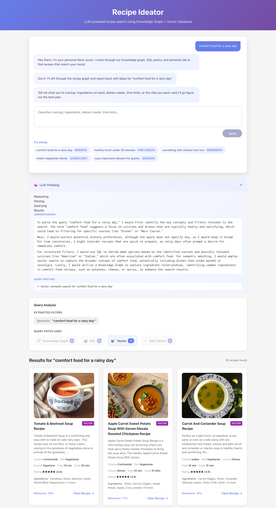

# Recipe Ideator

LLM-powered recipe search that fuses **structured SQL filters**, **pgvector semantic matching**, and a **Neo4j ingredient graph**. Frontend runs a conversational assistant that streams reasoning and guides users to relevant dishes (with lazy-loaded preview images).



*Semantic search in action: "comfort food for a rainy day" mentions no dish or ingredient, yet the vector path surfaces soups and stews. The assistant streams its reasoning and shows which query paths (knowledge graph, SQL, vector) produced the results.*

## Architecture

```
┌──────────────────────────────┐
│            Docker            │
│ ┌────────┐ ┌──────────────┐ │
│ │Frontend│ │ FastAPI API  │ │
│ │(nginx) │ │ (uvicorn)    │ │
│ └────────┘ └──────────────┘ │
│        ▲            ▲       │
│        │            │       │
│  Browser hits  /api │       │
│        │            │       │
│        │   ┌────────┴────┐  │
│        │   │ PostgreSQL  │  │
│        │   │ + pgvector  │  │
│        │   └────────┬────┘  │
│        │            │       │
│        │       ┌────┴───┐   │
│        │       │ Neo4j  │   │ (local container; Aura optional)
└────────┴───────┴─────────┘
```

- **Backend**: FastAPI + Uvicorn, streaming SSE responses for reasoning + search results.
- **Data plane**: Postgres (structured filters + pgvector embeddings) and Neo4j Aura for ingredient graph traversal.
- **Frontend**: React (Vite) served by nginx, acting as a chat-style assistant that streams updates.

## Getting Started (Local)

1. **Requirements**: Docker, Docker Compose, and an OpenAI API key.
2. **Copy env vars**: `cp .env.example .env` and fill in `POSTGRES_*`, `OPENAI_API_KEY`, and Neo4j Aura credentials.
3. **Bring up services**:
   ```bash
   docker-compose up -d
   ```
4. **Ingest data** (runs both Neo4j + Postgres loaders):
   ```bash
   docker-compose exec api uv run python -m src.data_ingestion.run
   ```
5. **Visit**:
   - Frontend: http://localhost:3000
   - API docs/health: http://localhost:8000/api/health
   - pgAdmin: http://localhost:5050 (defaults in `.env`)

## Production (EC2 Ubuntu)

1. Install Docker & compose plugin (avoid the snap build). Add your user to the `docker` group.
2. Clone repo + copy `.env` (including `VITE_API_URL=/api` so the bundle hits nginx).
3. Import a local data snapshot if desired:
   ```bash
   docker compose -f docker-compose.prod.yml exec -T postgres \
     psql -U recipe_user -d recipes < /path/to/recipes.sql
   ```
4. Launch stack:
   ```bash
   docker compose -f docker-compose.prod.yml up -d --build
   ```
5. Open port 80 in the EC2 security group and browse to the instance’s public IP.

## Self-hosting on a Raspberry Pi 5 (Tailscale Funnel)

Runs the full stack (including Neo4j, no Aura needed) on an 8 GB Pi 5 and exposes it at a stable public HTTPS URL, with no domain, router config, or public IP required.

1. **Pi prep** (64-bit Raspberry Pi OS; a USB SSD is recommended over the SD card):
   ```bash
   curl -fsSL https://get.docker.com | sh && sudo usermod -aG docker $USER   # re-login after
   curl -fsSL https://tailscale.com/install.sh | sh && sudo tailscale up
   ```
2. **Copy the repo + secrets + data** (backups are gitignored), from your machine:
   ```bash
   rsync -av --exclude node_modules --exclude .venv ./ pi@<pi-host>:~/food-recipe-ideator/
   # must include: .env (OPENAI_API_KEY), backups/recipes.sql, backups/neo4j-local/neo4j.dump
   ```
3. **Deploy** (first run restores Postgres + Neo4j from the backups; reruns just rebuild/restart):
   ```bash
   cd ~/food-recipe-ideator && ./ops/pi-deploy.sh
   ```
4. **Expose publicly** (first time, approve Funnel in the Tailscale admin console when prompted):
   ```bash
   sudo tailscale funnel --bg 80
   tailscale funnel status   # shows https://<pi-name>.<tailnet>.ts.net
   ```
   Containers use `restart: unless-stopped` and Funnel `--bg` persists, so the demo comes back after a reboot.

Refresh the Neo4j dump from a dev stack with:
`docker compose stop neo4j && docker run --rm -v food-recipe-ideator_neo4j_data:/data -v "$PWD/backups/neo4j-local":/backups neo4j:5 neo4j-admin database dump neo4j --to-path=/backups --overwrite-destination=true && docker compose start neo4j`

## Data Ingestion Tips

- SQL-only refresh (skip Aura): `docker-compose exec api uv run python -m src.data_ingestion.run --skip-neo4j`
- Dump Postgres for reuse: `docker-compose exec postgres pg_dump -U recipe_user -d recipes > backups/recipes.sql`
- Restore on another host: `docker compose exec -T postgres psql -U recipe_user -d recipes < backups/recipes.sql`

## Testing & Tooling

- Backend: `cd backend && uv run pytest`
- Frontend: `cd frontend && npm run build` (Vite handles TypeScript checks)
- Linting/formatting is handled via the respective build chains.

## Notable Features

- **Controlled vocabulary**: The LLM parser receives actual diet/course/ingredient lists from Postgres, so queries like “soy-based bean protein” map to real ingredients (Tofu, Tempeh).
- **Streaming UX**: The assistant shows typing indicators, search phases, skeleton cards, and query-path explanations that expand with details.
- **Preview images**: Backend scrapes OG/Twitter tags lazily and caches results; frontend lazy-loads cards with fallbacks.
- **Deployment-ready**: Separate `docker-compose.prod.yml`, nginx proxy, documented dump/restore and ingestion workflows.

## Environment Variables

See `.env.example` for the full list. Key settings:

| Variable | Purpose |
|----------|---------|
| `POSTGRES_*` | Credentials + DB name for pgvector store |
| `NEO4J_URI/USER/PASSWORD` | Aura connection for knowledge graph |
| `OPENAI_API_KEY` | Embedding + parsing + reasoning calls |
| `VITE_API_URL` | Set to `/api` in production so the frontend hits nginx |

## Contributing / Maintenance

- Rebuild frontend when changing API base URLs or nginx config.
- Keep `.env` in sync between local and production (especially OpenAI/Aura credentials).
- Monitor Docker logs with `docker compose logs -f api frontend` when debugging “Failed to fetch” or SSE issues.
- Controlled-vocab cache lives at `recipes-data/controlled_vocab.json`; delete it if the dataset changes drastically.
